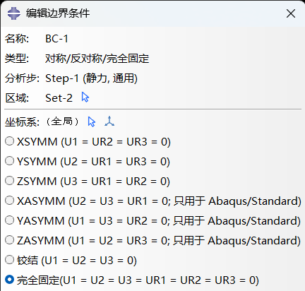
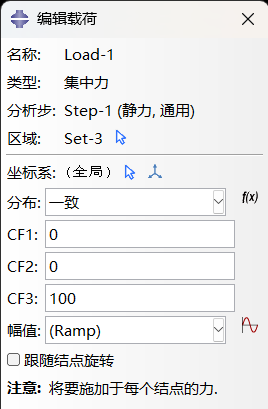
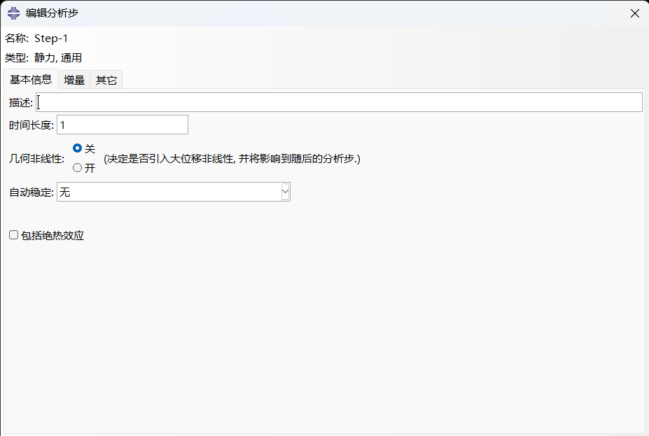
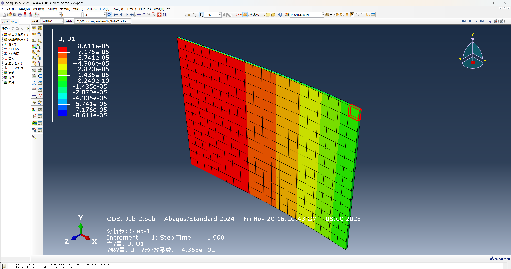
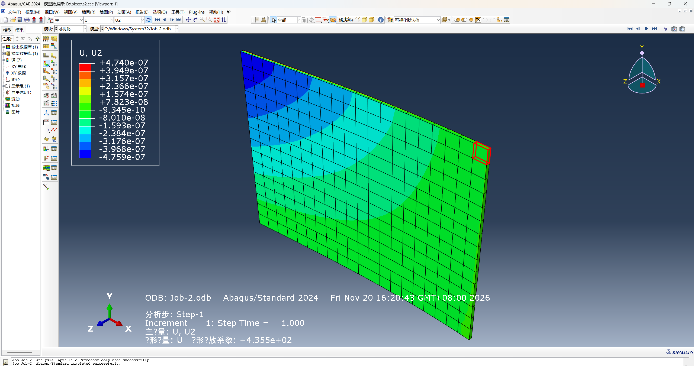
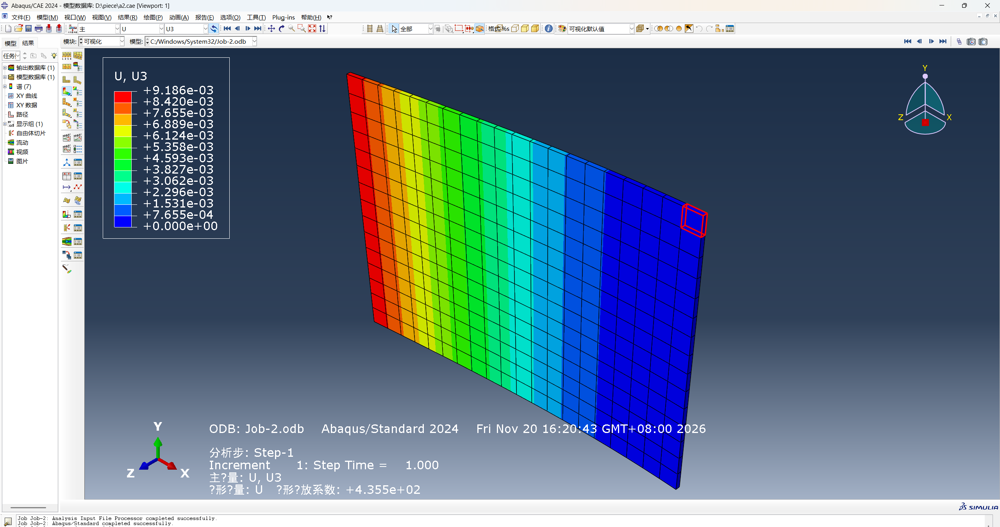

# 铝板静力应力分析

对同一块铝板（约 40 × 34 的板件）更换边界条件和载荷做的静力通用分析，用来看面外集中力下的应力与位移分布。

## 文件

| 文件 | 说明 |
| --- | --- |
| `a2.cae` | Abaqus 静力分析模型（含 `BC-1`、`Load-1`、`Job-2`） |
| `a2.jnl` | Abaqus 操作日志，可在 CAE 中重放重建模型 |
| `Drawing1.dxf` | AutoCAD 板件轮廓草图，与 `aluminum-plate-modal` 分支同一张 |
| `images/` | 边界条件、载荷设置与结果云图 |

## 边界条件

`BC-1`，类型「对称/反对称/完全固定」，取 **完全固定**，即 U1 = U2 = U3 = UR1 = UR2 = UR3 = 0；作用区域 `Set-2`。

## 载荷

`Load-1`，类型「集中力」，作用区域 `Set-3`，分布「一致」，幅值 `Ramp`：

- CF1 = 0
- CF2 = 0
- CF3 = 100

即沿 +Z 方向施加 100（模型单位）的集中力，作用于该区域内的每个节点。

## 分析步

`Step-1`，类型「静力, 通用」；时间长度 1，几何非线性关闭，自动稳定无；求解作业名 `Job-2`。

## 结果

### Mises 应力

- 变量 `S, Mises`（平均值阈值 75%）
- 最大值 46.32（模型单位为 mm / N 时即 MPa），峰值集中在受载角点，红色区域

### 位移

总体位移幅值：

分方向位移：

| 分量 | 图 |
| --- | --- |
| U1（面内 X） |  |
| U2（面内 Y） |  |
| U3（面外 Z） |  |

各分量极值：

| 分量 | 最大值 | 最小值 |
| --- | --- | --- |
| U, Magnitude | 9.186e-03 | 0 |
| U, U1 | +8.611e-05 | -8.611e-05 |
| U, U2 | +4.740e-07 | -4.759e-07 |
| U, U3 | 9.186e-03 | 0 |

U3 的最大值与 `U, Magnitude` 完全一致，说明位移几乎全部是面外（Z 向）弯曲：面内 U1 只有主位移的百分之一量级，U2 更小可忽略。所有云图的变形放大系数为 +4.355e+02，实际位移远小于图形显示。

## 复现

1. 用 Abaqus CAE 打开 `a2.cae`，提交 `Job-2` 求解；
2. 或在 CAE 中 `File > Run Script` 运行 `a2.jnl`。