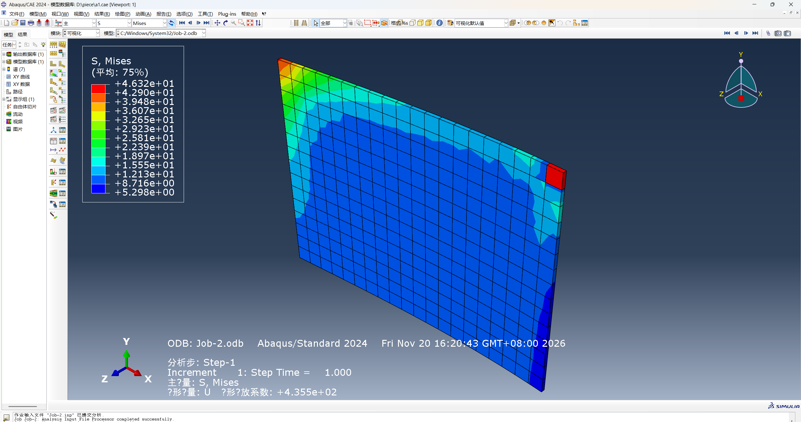

# 铝板静力应力分析

对 `aluminum-plate-modal` 那套板件模型换边界条件与载荷做的静力通用分析，用于对比同一结构在静载下的应力分布。

## 文件

| 文件 | 说明 |
| --- | --- |
| `Drawing1.dxf` | AutoCAD 板件轮廓草图（约 40 × 34），与模态分析分支同一张图 |
| `images/` | 边界条件、分析步设置与应力云图 |

模型几何与网格沿用 `aluminum-plate-modal` 分支的 `a1.cae`，本次只改了边界条件与分析步。

## 边界条件

`BC-1`，类型「对称/反对称/完全固定」，选择 **完全固定**，即 U1 = U2 = U3 = UR1 = UR2 = UR3 = 0；作用区域 `Set-2`，分析步 `Step-1 (静力, 通用)`。

## 分析步

`Step-1`，类型「静力, 通用」；时间长度 1，几何非线性关闭，自动稳定无。求解输出作业名 `Job-2`。

## 结果

- 变量：`S, Mises`（平均值 75% 阈值）
- 最大值：46.32（模型单位为 mm / N 时即 MPa），峰值出现在图右上角的红色区域
- 变形放大系数：+4.355e+02，即实际位移远小于图形所见

## 待补充

集中载荷的具体位置、方向与大小尚未记录在库中，待补。