# 铝板动力显式分析（基础加速度激励）

在铝板模型上用 Abaqus/Explicit 做的动力分析：一端固定，另一端施加基础加速度激励，并对比「恒定激励」与「加幅值限制」两种设置。

## 文件

| 文件 | 说明 |
| --- | --- |
| `a3.cae` | 动力显式模型（`Step-1`、`BC-1`、`BC-2`，作业 `Job-3` / `Job-4`） |
| `a3.jnl` | Abaqus 操作日志，可在 CAE 中重放 |
| `Drawing1.dxf` | AutoCAD 板件轮廓草图，与模态、静力两个分支同一张 |
| `images/` | 13 张设置与结果截图 |

## 分析步

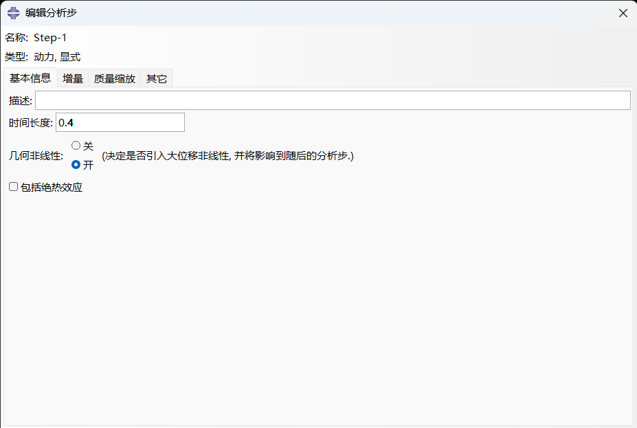

`Step-1`，类型「动力, 显式」；时间长度 0.4；几何非线性 **开**。

## 场输出

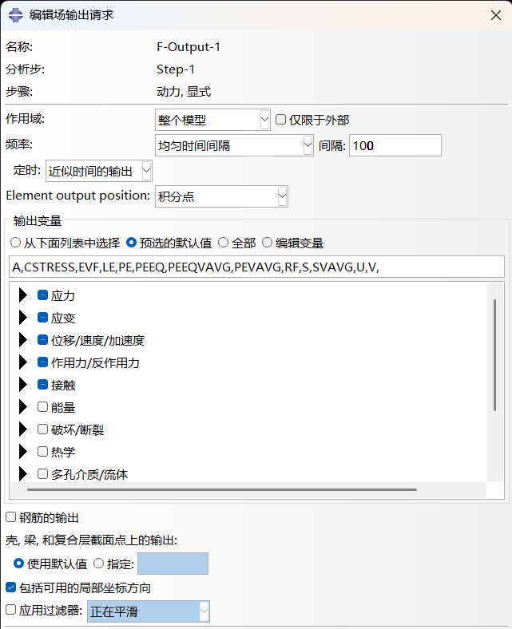

`F-Output-1`，作用域「整个模型」，频率「均匀时间间隔」100；输出变量为预设默认（`A`、`S`、`U`、`V`、`RF` 等），单元输出位置为积分点。

## 边界条件

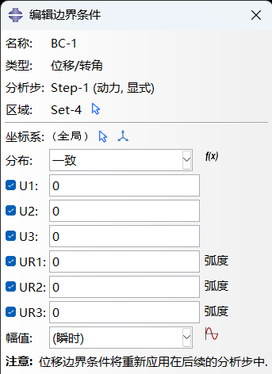

`BC-1`，类型「位移/转角」，作用区域 `Set-4`，U1–UR3 全为 0，幅值「瞬时」，即该处完全约束。

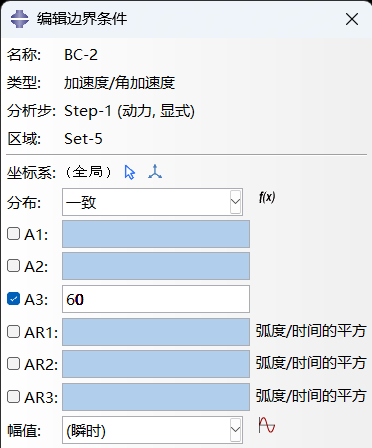

`BC-2`，类型「加速度/角加速度」，作用区域 `Set-5`，仅 A3 = 60（沿 Z 向），分布「一致」。

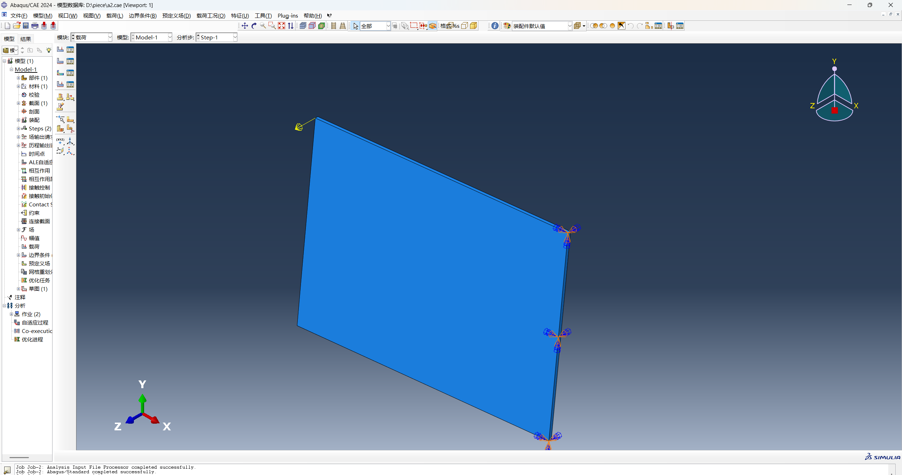

## 激励幅值的两种设置

本次对比的核心是 `BC-2` 的幅值：

- 第一版：幅值「瞬时」，加速度全程恒定 → 作业 `Job-3`
- 第二版：幅值改为 `Amp-1`，对激励加以限制 → 作业 `Job-4`

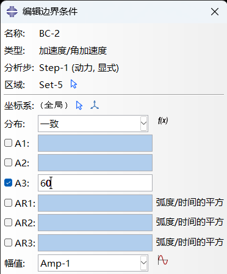

Amp-2 与 Amp-1 是同一份数据（当时为了查看 Amp-1 里的取值，另建了一个同样内容的幅值来截图），所以看 Amp-2 的表格即可知道 Amp-1 的形状：时间跨度「分析步时间」，平滑用求解器默认，数据点为 (0, 0)、(0.1, 1)、(0.2, 0)。

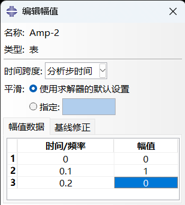

## 网格

## 结果

### Job-3：恒定激励

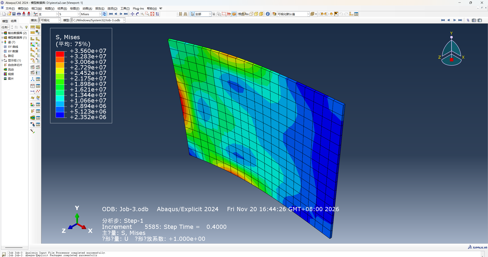

Mises 最大值 3.560e+7，Step Time = 0.4000，第 5585 增量。

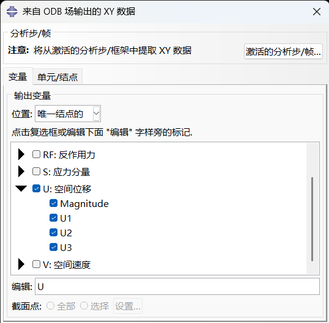

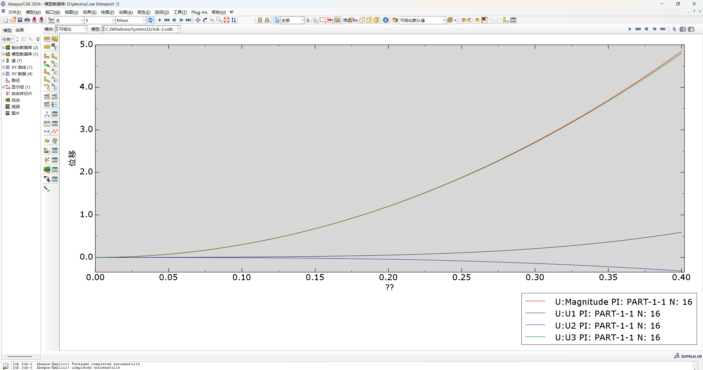

0.4 s 内 U3 增至约 4.6，U1 约 0.5，U2 是很小的负值；`U, Magnitude` 与 U3 基本重合。

### Job-4：加幅值限制

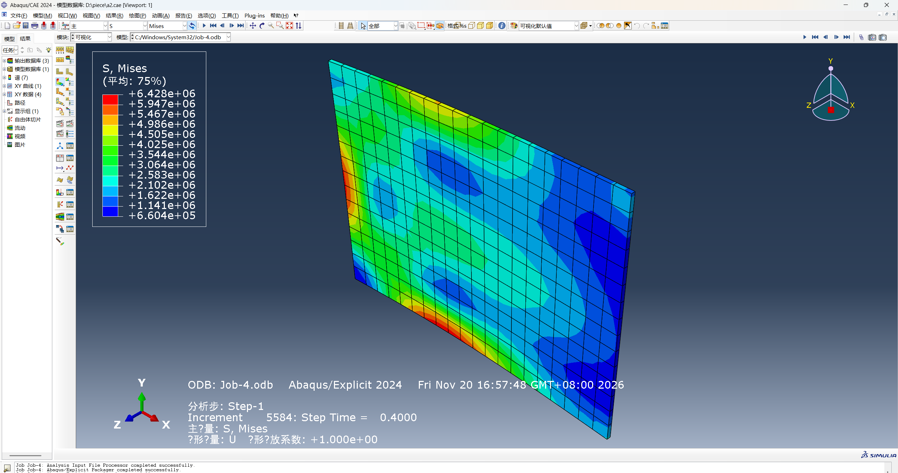

Mises 最大值 6.428e+6，第 5584 增量。

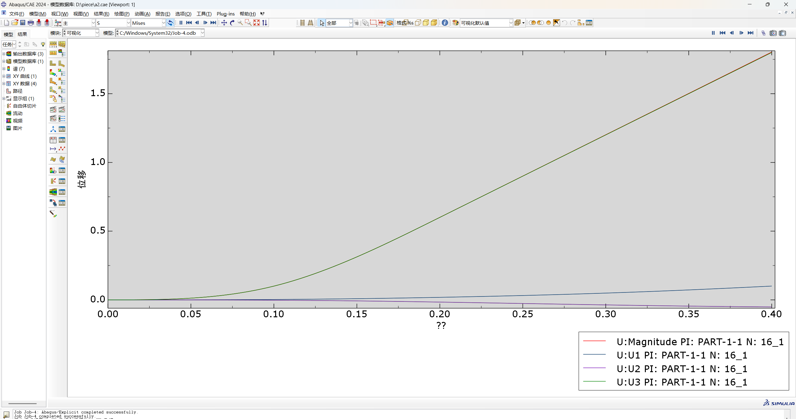

U3 在 0.4 s 末约 1.75，明显小于 Job-3。

## 注意

- Amp-1 的形态是三角脉冲：0→0.1 s 从 0 线性升到 1，0.1→0.2 s 回落到 0，0.2→0.4 s 保持 0。按时间积分，它的总冲量只有恒定激励的约 1/4（6 对 24），但 Mises 峰值降到约 1/5.5、末时刻位移降到约 1/2.6，比例并不一致——这属于动力问题的正常现象：应变率、惯性滞后和 0.2 s 之后的自由振动段都不是线性缩放关系，不必据此怀疑设置出错。
- 本分支的应力数值（1e6~1e7）与静力分支的最大值 46.32 相差约六个数量级，两个模型的单位制很可能不一致，引用数值前需要核对。

## 复现

1. 用 Abaqus CAE 打开 `a3.cae`，提交 `Job-3` 或 `Job-4`；
2. 或在 CAE 中 `File > Run Script` 运行 `a3.jnl`。