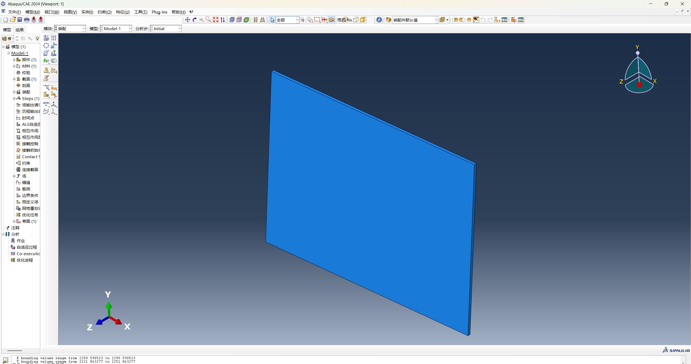
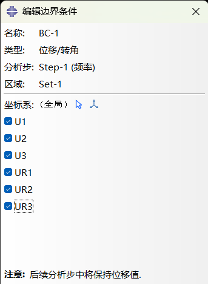
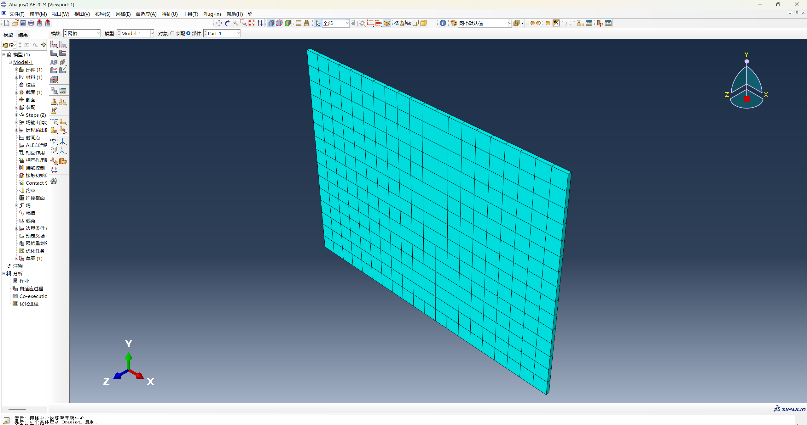
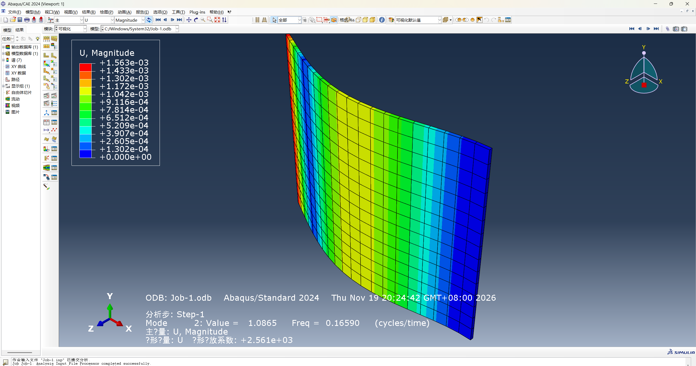
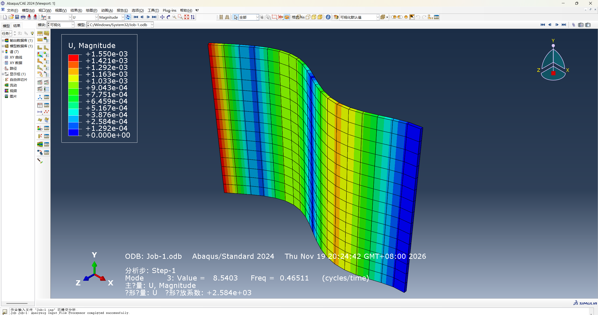
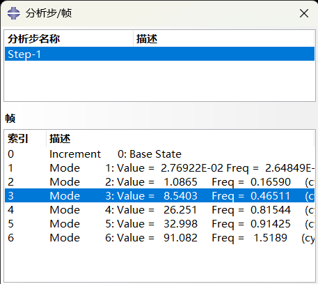

# 铝板模态振动分析

Abaqus 频率提取（Frequency Step）+ AutoCAD 板件草图，课程练习。

## 文件

| 文件 | 说明 |
| --- | --- |
| `a1.cae` | Abaqus 模型：部件、材料（Elastic + Density）、截面、网格与频率提取步 |
| `a1.jnl` | Abaqus 操作日志，可在 CAE 中重放重建模型 |
| `Drawing1.dxf` | AutoCAD 板件轮廓草图（约 40 × 34） |
| `images/` | 建模过程与求解结果截图，见下节 |
| `Drawing1.bak` | AutoCAD 自动备份，未纳入版本管理 |

## 建模与求解过程

### 1. 模型

板件实体，轮廓由 AutoCAD 草图 `Drawing1` 导入，位于坐标 (2250, 2221) 附近。

### 2. 边界条件

`BC-1`，类型「位移/转角」，分析步 `Step-1 (频率)`，作用区域 `Set-1` 取板件的一个侧面；U1–UR3 六个自由度全部锁死，即该侧面完全固支，其余部分自由。对应一端固定、一端自由的边界形式。

### 3. 网格

四边形单元网格，长宽方向各十余个单元。

## 模态结果

六阶频率（Abaqus 输出的特征值与 cycles/time）：

| 阶次 | 特征值 | 频率 |
| --- | --- | --- |
| 1 | 2.76922e-02 | 2.64849e-02 |
| 2 | 1.0865 | 0.16590 |
| 3 | 8.5403 | 0.46511 |
| 4 | 26.251 | 0.81544 |
| 5 | 32.998 | 0.91425 |
| 6 | 91.082 | 1.5189 |

### 一阶振型（0.0265）

### 二阶振型（0.1659）

### 三阶振型（0.4651）

### 帧列表

云图变量均为位移幅值 `U, Magnitude`，颜色范围为归一化后的相对值，不代表实际振动幅值。

## 复现

1. 用 Abaqus CAE 打开 `a1.cae`，提交 `Job-1` 求解；
2. 或在 CAE 中 `File > Run Script` 运行 `a1.jnl`，自动重建整个模型。